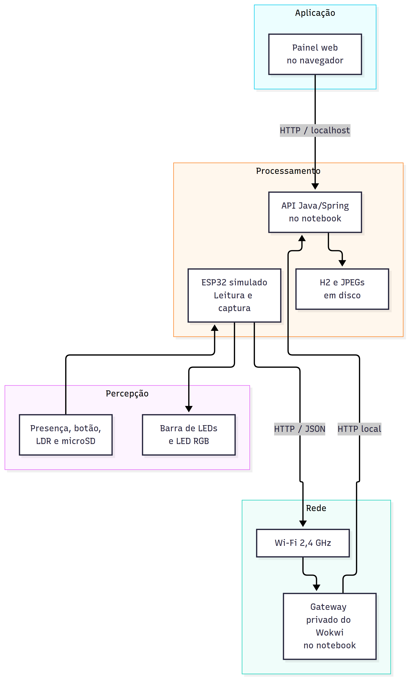
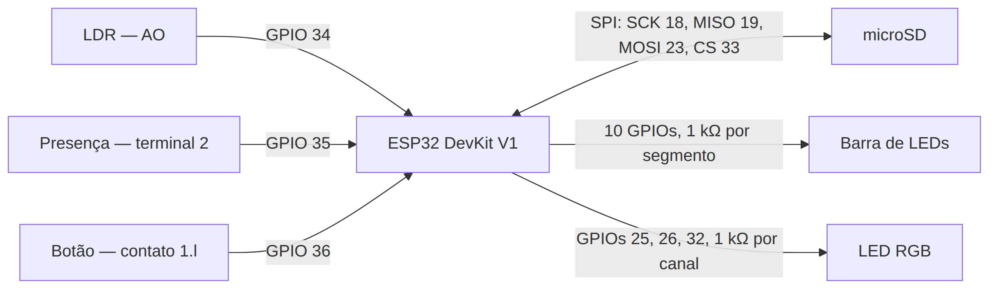

```{=typst}
#show heading.where(level: 1): set text(size: 22pt)
#show link: set text(fill: rgb("#1b4e72"))
#v(30mm)
```

# PetriLens Station — Estação IoT de captura de placas de Petri

**Relatório técnico da disciplina de IoT**

**Integrantes**

- Pablo Vinicius de Campos Souza
- Douglas Bruno Campos de Souza
- Entony Gabriel De Lima Wittmann

23 de novembro de 2026

```{=typst}
#pagebreak()
```

## Problema e solução

Em laboratórios de microbiologia de alimentos, fotografar placas de Petri com o celular introduz variações de distância, ângulo e iluminação. Isso dificulta a comparação entre imagens e a contagem automatizada de colônias de *Salmonella* spp. prevista no projeto PetriLens. A estação atende diretamente ao operador, o técnico de laboratório que prepara a captura na bancada e consulta seu registro. A proposta também identifica analistas de alimentos, estudantes e pesquisadores como público da aplicação mais ampla. [Proposta aprovada](proposta.md) · [Glossário](../GLOSSARY.md)

A estação foi concebida para manter a placa em posição fixa no berço e iluminá-la de forma controlada. No painel, o operador seleciona uma amostra de um lote existente. Cada captura fica vinculada à amostra selecionada no momento da captura, com a leitura de luz e o horário registrado pelo servidor. O painel permite consultar as capturas por amostra. O escopo termina no registro e na consulta de um JPEG fictício, sem análise de colônias de material real. [ADR 0002](adr/0002-servidor-proprio-em-spring.md) · [ADR 0004](adr/0004-camera-simulada-por-jpeg-no-sd.md) · [Decisões](decisoes.md)

A proposta original descrevia a colocação da placa no berço como início do fluxo de captura e previa confirmar uma faixa ideal de luz. Pelo ADR 0006, a presença acende a barra de LEDs e é condição para a captura, que exige um disparo explícito pelo botão ou pelo comando do painel. O firmware também exige uma leitura entre 300 e 700 lx para a demonstração. No Wokwi, o operador ajusta o LDR por um controle independente da barra, então a regra trabalha sem realimentação da iluminação. [Proposta aprovada](proposta.md) · [ADR 0006](adr/0006-gatilho-da-captura-e-sensor-de-luz.md) · [Fluxo de captura](../firmware/sketch/captura.cpp) · [Contrato da API](api.md)

```{=typst}
#pagebreak()
```

## Arquitetura em quatro camadas

Na demonstração, o Wokwi para VS Code usa o gateway privado da extensão para alcançar o servidor no notebook. O navegador do operador acessa o painel por localhost. A estação inicia as requisições e recebe a amostra selecionada e, se houver, um comando pendente na resposta à sincronização. [ADR 0008](adr/0008-wokwi-vscode-com-gateway-local.md) · [ADR 0005](adr/0005-estacao-inicia-toda-comunicacao.md)

{width=65%}

- **Percepção.** A chave deslizante representa a chave reed do berço, o LDR informa a luminosidade e o botão solicita a captura. A barra branca representa a iluminação de captura, e o RGB indica o estado na bancada. O JPEG fictício vem do microSD porque a câmera OV2640 fica fora da simulação. [ADR 0004](adr/0004-camera-simulada-por-jpeg-no-sd.md) · [ADR 0006](adr/0006-gatilho-da-captura-e-sensor-de-luz.md)
- **Rede.** O ESP32 usa seu Wi-Fi integrado. O gateway privado encaminha as requisições HTTP ao servidor em localhost. A estação inicia as trocas, então o servidor pode devolver instruções sem precisar abrir uma conexão com o simulador. [ADR 0008](adr/0008-wokwi-vscode-com-gateway-local.md) · [ADR 0005](adr/0005-estacao-inicia-toda-comunicacao.md)
- **Processamento.** O ESP32 lê as entradas, aciona a iluminação e o RGB e sincroniza antes de uma captura pelo botão. Java/Spring foi escolhido por ser familiar aos três integrantes para implementação e defesa. O servidor valida as requisições e guarda seleção e metadados em H2 em arquivo, dispensando um serviço de banco separado. Os JPEGs ficam em disco e o último estado informado fica em memória. [ADR 0002](adr/0002-servidor-proprio-em-spring.md) · [README](../README.md)
- **Aplicação.** O servidor entrega um painel em HTML e JavaScript que roda no navegador, sem etapa de compilação de frontend. O operador escolhe a amostra, acompanha o estado informado pela estação e consulta horário, lux e miniaturas das capturas da amostra selecionada. [ADR 0002](adr/0002-servidor-proprio-em-spring.md) · [Painel](../servidor/src/main/resources/static/painel.js)

## Hardware

O circuito simulado contém um ESP32 DevKit V1, um módulo LDR, uma chave deslizante de presença, um botão de pressão, um módulo microSD, uma barra de dez segmentos brancos e um LED RGB de cátodo comum. São usados dois resistores de 10 kΩ como pull-ups externos e treze resistores de 1 kΩ em série com os LEDs, dez para a barra e três para o RGB. O microSD disponibiliza o JPEG fictício em `/placa-base64.txt`, copiado de `sdcard/` pelo simulador a cada início. [Circuito](../firmware/sketch/diagram.json) · [Leitura do microSD](../firmware/sketch/imagem.cpp) · [ADR 0004](adr/0004-camera-simulada-por-jpeg-no-sd.md)

### Diagrama de ligações

{width=100%}

```{=typst}
#pagebreak(weak: true)
```

### Tabela de pinos

Todos os retornos ao terra chegam a `GND.1`. Na barra, cada ânodo `A1` a `A10` tem um resistor de 1 kΩ em série e cada cátodo `C1` a `C10` vai ao terra. Os rótulos entre parênteses são os nomes dos pinos no `diagram.json`. [Circuito](../firmware/sketch/diagram.json)

| Componente e terminal | Pino do ESP32 | Ligação |
| :------------------------ | :------------------ | :------------------------------------------ |
| LDR `AO` | 34 (`D34`) | Leitura analógica. `VCC` em `3V3`, `GND` em `GND.1` e `DO` livre. |
| Chave de presença, terminal `2` | 35 (`D35`) | Pull-up externo de 10 kΩ a `3V3`. Terminal `1` ao terra, terminal `3` livre. Nível baixo indica placa presente. |
| Botão, contato `1.l` | 36 (`VP`) | Pull-up externo de 10 kΩ a `3V3`. Contato `2.l` ao terra. Pressionado em nível baixo. |
| microSD `SCK` | 18 (`D18`) | Clock SPI. |
| microSD `DO` | 19 (`D19`) | MISO, dados do cartão para o ESP32. |
| microSD `DI` | 23 (`D23`) | MOSI, dados do ESP32 para o cartão. |
| microSD `CS` | 33 (`D33`) | Seleção do cartão. |
| microSD `VCC` / `GND` | `3V3` / `GND.1` | Alimentação de 3,3 V e terra. |
| Barra, segmento 1 | 5 (`D5`) | `A1` / `C1` |
| Barra, segmento 2 | 3 (`RX0`) | `A2` / `C2` |
| Barra, segmento 3 | 4 (`D4`) | `A3` / `C3` |
| Barra, segmento 4 | 13 (`D13`) | `A4` / `C4` |
| Barra, segmento 5 | 14 (`D14`) | `A5` / `C5` |
| Barra, segmento 6 | 16 (`RX2`) | `A6` / `C6` |
| Barra, segmento 7 | 17 (`TX2`) | `A7` / `C7` |
| Barra, segmento 8 | 21 (`D21`) | `A8` / `C8` |
| Barra, segmento 9 | 22 (`D22`) | `A9` / `C9` |
| Barra, segmento 10 | 27 (`D27`) | `A10` / `C10` |
| RGB `R` | 25 (`D25`) | Vermelho via 1 kΩ. |
| RGB `G` | 26 (`D26`) | Verde via 1 kΩ. |
| RGB `B` | 32 (`D32`) | Azul via 1 kΩ. |
| RGB `COM` | `GND.1` | Cátodo comum ao terra. |

Os GPIOs 34, 35 e 36 são entradas sem pull-up interno. A chave e o botão precisam dos resistores externos para manter nível alto em repouso. O GPIO 34 lê a saída analógica do LDR pelo ADC1 em 12 bits, com atenuação de 11 dB. O firmware converte a leitura em uma estimativa nominal de lux para o modelo Wokwi a 3,3 V. No simulador, a estimativa acompanhou o controle do LDR: 500 lx no controle resultaram em 499,6 lx e 263 lx em 262,9 lx. O GPIO 3 é usado pela barra, portanto o firmware não inicializa a UART do Monitor Serial. O RGB indica espera em amarelo, pronta em verde, captura e envio em azul e erro em vermelho. [Sensores](../firmware/sketch/sensores.cpp) · [Iluminação](../firmware/sketch/iluminacao.cpp) · [Status](../firmware/sketch/status.cpp) · [README](../README.md)

```{=typst}
#pagebreak(weak: true)
```

## Software

### Firmware da estação

O firmware é um sketch Arduino em C++ para o ESP32. A compilação local usa o core Arduino-ESP32 3.3.13. A biblioteca ArduinoJson 7.4.3 serializa as mensagens e interpreta a resposta à sincronização. O core fornece `WiFi`, `NetworkClient`, `NetworkClientSecure` e `HTTPClient` para a rede e o cliente HTTP ou HTTPS, além de `SPI` e `SD` para o cartão. O módulo de imagem usa mbed TLS para Base64 e criptografia. [README](../README.md) · [Bibliotecas do sketch](../firmware/sketch/libraries.txt) · [Cliente do servidor](../firmware/sketch/cliente_servidor.cpp) · [Módulo de imagem](../firmware/sketch/imagem.cpp)

O `sketch.ino` inicializa os módulos e coordena o laço de execução. `sensores.cpp` lê a chave de presença, estima o lux a partir do ADC e só considera a leitura do botão estável após 30 ms. `iluminacao.cpp` acende o número configurado de segmentos com a placa presente e apaga a barra quando ela é retirada, uma decisão local que independe da rede. `status.cpp` controla o RGB e mantém o vermelho ligado enquanto faltar Wi-Fi. `rede.cpp` inicia a conexão Wi-Fi como cliente, habilita a reconexão automática e informa o RSSI. [Laço do firmware](../firmware/sketch/sketch.ino) · [Sensores](../firmware/sketch/sensores.cpp) · [Iluminação](../firmware/sketch/iluminacao.cpp) · [Status](../firmware/sketch/status.cpp) · [Rede](../firmware/sketch/rede.cpp)

O botão e o comando `capturar` acionam a mesma rotina, em `captura.cpp`. Pelo botão, o laço exige uma sincronização bem-sucedida antes de chamar a rotina. Pelo painel, a seleção vem junto com o comando. A rotina verifica presença, configuração, conexão, amostra e luz. A faixa aceita vai de 300 a 700 lx, com ambos os limites inclusivos. Leituras fora da faixa ou não finitas acendem o RGB vermelho por 3 s e encerram a tentativa antes de abrir o cartão. O motivo `lux_fora_da_faixa` segue nas sincronizações até uma tentativa passar pela verificação de luz. Antes de enviar, a rotina ainda confere se a placa continua presente. [Captura](../firmware/sketch/captura.cpp) · [Laço do firmware](../firmware/sketch/sketch.ino) · [Decisões](decisoes.md)

`imagem.cpp` abre o arquivo no microSD e decodifica o Base64 em blocos durante a cifragem. O resultado fica em um buffer binário. `cliente_servidor.cpp` concentra a configuração do destino e o protocolo da API. No envio, transforma o conteúdo cifrado em Base64 à medida que escreve o corpo JSON, evitando manter uma segunda cópia integral como texto. Tenta o POST até três vezes e espera HTTP 201. Se perder a resposta de um POST já gravado no servidor, uma nova tentativa pode duplicar a captura. Se todas as tentativas falharem, a estação sinaliza erro e descarta a captura. Na sincronização, o cliente interpreta até um comando. `status` solicita uma nova sincronização no próximo ciclo apto, e `ajustar_brilho` aceita de 0 a 10 segmentos. [Módulo de imagem](../firmware/sketch/imagem.cpp) · [Cliente do servidor](../firmware/sketch/cliente_servidor.cpp) · [Laço do firmware](../firmware/sketch/sketch.ino)

### Servidor e painel

O servidor tem Java 21 como alvo de compilação e usa Spring Boot 3.5.16, com Maven para empacotar o JAR. Spring Web expõe a API e serve os arquivos estáticos. Jackson e Jakarta Validation tratam o JSON e a validação de campos. Spring Security aplica os controles de acesso, e Spring JDBC usa um H2 em arquivo. O código se organiza nos pacotes `amostra`, `estacao`, `comando` e `captura`, com `seguranca` e `erro` para autenticação, proteção das rotas e respostas de erro. O banco é inicializado com dois lotes fictícios de três amostras cada. [Dependências Maven](../servidor/pom.xml) · [Código do servidor](../servidor/src/main/java/br/com/petrilens/) · [Catálogo inicial](../servidor/src/main/resources/data.sql)

A sincronização mantém o último estado recebido em memória. Em uma transação, o servidor lê a amostra selecionada e marca como entregue o comando pendente mais antigo, quando houver. O bloqueio usado na entrega também protege a atualização da seleção e evita devolver o mesmo comando em sincronizações concorrentes. Na captura, a API limita o corpo a 65.536 bytes antes de interpretar o JSON, verifica o vínculo entre amostra e lote, decifra a imagem e valida se o JPEG pode ser lido nas dimensões de 800 × 600. O servidor usa o horário de recebimento, grava o JPEG em disco e depois registra os metadados no H2. [API de estado](../servidor/src/main/java/br/com/petrilens/estacao/EstacaoController.java) · [Fila de comandos](../servidor/src/main/java/br/com/petrilens/comando/Comandos.java) · [Seleção](../servidor/src/main/java/br/com/petrilens/amostra/Amostras.java) · [API de captura](../servidor/src/main/java/br/com/petrilens/captura/CapturaController.java) · [Persistência da captura](../servidor/src/main/java/br/com/petrilens/captura/Capturas.java)

O painel usa HTML e JavaScript. Pelo navegador, o operador seleciona a amostra, envia os três tipos de comando e consulta o histórico de entrega. O painel distingue a seleção do servidor da amostra informada pela estação. Também exibe o último estado recebido, o aviso de recusa por lux e as capturas da amostra selecionada, com horário, lux e miniatura. [Página do painel](../servidor/src/main/resources/static/index.html) · [Rotinas do painel](../servidor/src/main/resources/static/painel.js)

## Comunicação

### Rede e protocolo

A estação usa Wi-Fi de 2,4 GHz e requisições HTTP com JSON. Para uma estação fixa próxima ao roteador, o alcance esperado é compatível com uma bancada de laboratório. A taxa do Wi-Fi é adequada a envios eventuais de JPEGs, além das mensagens pequenas de estado. O consumo do rádio pesa menos nesse uso em bancada do que em um equipamento remoto a bateria. O Wi-Fi integrado ao ESP32 reaproveita a infraestrutura do laboratório e dispensa um rádio adicional. Esses critérios são qualitativos. [Proposta aprovada](proposta.md)

O ESP32 se associa à rede simulada `Wokwi-GUEST`. O endereço `http://host.wokwi.internal:8080` passa pelo gateway privado do Wokwi para VS Code e chega ao Spring em `127.0.0.1:8080`, no mesmo notebook. O painel abre por `http://localhost:8080`. O projeto Wokwi web continua público como item de entrega. A demonstração usa dados fictícios e uma chave exclusiva e descartável. [ADR 0008](adr/0008-wokwi-vscode-com-gateway-local.md) · [README](../README.md#simular-no-wokwi-para-vs-code)

### Sincronização e captura

Os tempos a seguir são os especificados no firmware, servidor e painel. A estação inicia uma sincronização nominal a cada 5 s e sincroniza antes da captura pelo botão para obter a seleção do servidor. As chamadas são síncronas, com limites de 4 s configurados separadamente para conexão e leitura. No modo HTTPS, o cliente também configura 4 s para a negociação TLS. O servidor considera a estação online até 15 s, inclusive, após a última sincronização aceita, e offline depois desse limite. O painel consulta a API e agenda o próximo ciclo 2 s após o anterior. O servidor devolve até um comando pendente por sincronização. Ele marca o comando como entregue ao incluí-lo na resposta, sem confirmar a execução na estação. [ADR 0005](adr/0005-estacao-inicia-toda-comunicacao.md) · [Laço do firmware](../firmware/sketch/sketch.ino) · [Cliente do servidor](../firmware/sketch/cliente_servidor.cpp) · [API de estado](../servidor/src/main/java/br/com/petrilens/estacao/EstacaoController.java) · [Painel](../servidor/src/main/resources/static/painel.js)

O `POST /api/estacao/sincronizacao` envia JSON UTF-8 com nomes em `snake_case`. O corpo informa identificador da estação, presença, lux, brilho em número de segmentos, amostra em uso, RSSI em dBm e tempo desde a inicialização em segundos. A resposta devolve a amostra selecionada com os identificadores de lote e amostra. Quando há um comando pendente, ele vem no array `comandos` junto com a amostra selecionada. A captura usa outro POST, `/api/estacao/capturas`, com a imagem e os metadados, sob o limite de 65.536 bytes para o corpo inteiro. O servidor vincula a captura à amostra informada no pedido, mesmo que o operador já tenha mudado a seleção. [Contrato versionado da API](api.md)

```{=typst}
#pagebreak(weak: true)
```

### Exemplo real de mensagem

Em 23/11/2026, durante o teste de recusa por luz baixa (L2), o ESP32 simulado no Wokwi enviou a sincronização abaixo ao servidor no notebook. A placa estava no berço, a amostra A5 estava selecionada e o LDR media cerca de 110 lx. O botão foi recusado na estação, que passou a informar o motivo da recusa. Os campos estão na ordem montada pelo firmware, com os valores registrados pelo servidor. A chave da estação segue no cabeçalho `X-Api-Key` e foi omitida.

```http
POST /api/estacao/sincronizacao
Content-Type: application/json

{
  "estacao_id": "est-01",
  "presenca": true,
  "lux": 109.6622,
  "brilho": 10,
  "amostra_id": "A5",
  "rssi": -83,
  "uptime_s": 251,
  "motivo_recusa": "lux_fora_da_faixa"
}
```

O servidor respondeu com HTTP 200, a amostra A5 do lote L2026-002 e o array `comandos` vazio. Na consulta seguinte, o painel exibiu **Captura recusada: luz fora da faixa ideal.**, e a lista de capturas de A5 ficou inalterada. Quando não há recusa, o campo `motivo_recusa` não é enviado. [Cliente do servidor](../firmware/sketch/cliente_servidor.cpp) · [Roteiro de testes](roteiro-wokwi.md)

```{=typst}
#pagebreak(weak: true)
```

## Testes

### Provas locais automatizadas

- **Suíte HTTP do servidor.** Na base de integração `238f439`, o comando `mvn -B -f servidor/pom.xml clean package` aprovou 13 testes, sem falhas. Eles cobrem autenticação, sincronização, seleção, comandos, captura, consulta protegida e persistência. A suíte foi repetida com o mesmo resultado em 23/11/2026, após a revisão de legibilidade e o ajuste visual do painel. A API retornou HTTP 400 ao receber dados cifrados adulterados ou cifrados para outro par RSA, sem registrar a captura. [Testes HTTP](../servidor/src/test/java/br/com/petrilens/) · [Registro das provas](roteiro-wokwi.md#provas-locais-já-realizadas)
- **Compilação para ESP32.** O `arduino-cli`, no alvo `esp32:esp32:esp32doit-devkit-v1`, informou 1.096.808 B de flash (83%) e 49.432 B de RAM global (15%) na revisão final. Os asserts em compilação aceitam 300 e 700 lx e rejeitam 299 e 701 lx, NaN e ambos os infinitos. [Instruções de compilação](../README.md#firmware-local) · [Asserts de lux](../firmware/sketch/captura.cpp)
- **Prova HTTP em localhost.** Com o JAR, `curl` e dados de teste, a prova confirmou a seleção A5 na sincronização, a entrega única de comando, a aceitação do brilho 4 e a recusa de 11. A API exibiu o motivo de recusa por lux no estado da estação e o removeu ao receber estado sem recusa. Um POST cifrado de 38.884 B vinculou a captura à A5, e a consulta recuperou o JPEG byte a byte após reiniciar o JAR. [Script da prova](../scripts/teste-local.sh) · [Registro das provas](roteiro-wokwi.md#provas-locais-já-realizadas)

### Ensaio Wokwi de ponta a ponta

O ensaio de 18/11/2026 usou o Wokwi para VS Code 4.1.0 com a build normal do firmware e o servidor no mesmo notebook. [Roteiro de testes](roteiro-wokwi.md)

- **Sincronização (P2).** O ESP32 simulado obteve o IP `10.13.37.2`, resolveu `host.wokwi.internal` e enviou `POST /api/estacao/sincronizacao` a cada 5 s simulados, com HTTP 200. O painel exibiu `est-01: online`. Com a aba do simulador oculta, a simulação pausa e o painel passa a offline após 15 s, como previsto.
- **Controle de acesso (P5).** Com `curl` em `127.0.0.1:8080`, a sincronização sem chave, com chave incorreta ou só com HTTP Basic recebeu 401. O painel, seus arquivos e sua API recusaram acesso sem Basic, com Basic incorreto ou só com a chave da estação. Com as credenciais corretas, cada lado funcionou apenas na sua rota.
- **Captura de ponta a ponta (C1).** Uma captura pelo botão em A1 chegou ao painel. A imagem baixada tem 28.754 B e o mesmo SHA-256 da fixture `exemplos/placa-ficticia.jpg`, ou seja, o JPEG atravessou a cifragem no ESP32 e a decifragem na API sem alteração.

A rodada final, em 23/11/2026, repetiu o ensaio com o firmware revisado e completou os demais casos operados à mão. O vídeo de entrega registra o fluxo principal. [Roteiro de testes](roteiro-wokwi.md)

- **Presença e iluminação (F1).** A chave de presença acendeu os 10 segmentos e deixou o RGB verde, com **Presente** no painel. Ao retirá-la, a barra apagou, o RGB voltou ao amarelo e o painel indicou **Ausente**, com a estação ainda online.
- **Seleção, comandos e capturas (F3, F4, F6, F8, L1).** A amostra A5 escolhida no painel chegou à estação na sincronização seguinte. O comando de brilho 4 foi entregue e a estação passou a informar 4 segmentos. Com cerca de 480 lx, o botão e o comando **Capturar** geraram capturas em A5, cada uma com HTTP 201 e a sequência verde, azul, verde no RGB.
- **Faixa de luz (L2, L3, L4).** Com 109,7 lx e com 3.167,8 lx, o botão foi recusado na estação: RGB vermelho, aviso **Captura recusada: luz fora da faixa ideal.** no painel e nenhuma captura nova. Com 550 lx, a captura seguinte foi aceita e o aviso desapareceu. Os limites exatos de 300 e 700 lx ficaram cobertos apenas pelos asserts de compilação.
- **Persistência (C1, C3).** Com o firmware revisado, uma nova captura voltou a chegar com o SHA-256 da fixture. Depois de reiniciar o JAR três vezes no mesmo diretório, a seleção, as capturas e o JPEG permaneceram idênticos.
- **Não executados.** P1 (outra máquina seguindo só o README), P3 e P4 (modo HTTPS), R1 a R4 e C2 (cópias modificadas do firmware ou servidor interrompido durante o envio) e C4 ficaram fora da rodada por tempo. A recusa por outro par RSA, objeto de C2, está coberta pelo teste HTTP de integridade.

### Falha, correção e reteste

**Falha.** No ensaio de 18/11/2026 (P2), o ESP32 simulado associou ao Wi-Fi pelo gateway privado (`10.13.37.2`) e resolveu o domínio ngrok. A borda encerrou o handshake com mbedTLS `-0x0050` (`MBEDTLS_ERR_NET_CONN_RESET`). Com ISRG Root X1, a cadeia exigiu três verificações ECDSA P-384 e uma RSA. O handshake durou cerca de 23 s simulados. Ancorar na intermediária YE2 reduziu o tempo para cerca de 11 s, mas a falha persistiu. Em um teste no notebook, a borda também desconectou um cliente TLS que atrasou a resposta em 3 s. [ADR 0008](adr/0008-wokwi-vscode-com-gateway-local.md)

**Correção e reteste.** O commit `ebdb136` habilitou HTTP apenas para o prefixo `http://host.wokwi.internal:`, via gateway privado no notebook. No reteste, o log serial registrou `connected to host.wokwi.internal:8080` e a sincronização retornou HTTP 200 cerca de 10 s após o boot simulado. [Registro do ensaio](roteiro-wokwi.md#registro-de-falha-e-reteste)

**Segunda falha: segmento da barra apagado.** No mesmo ensaio (F1), a barra mostrou 9 de 10 segmentos com brilho 10. A causa foi o GPIO 1 (TX0), que não aciona LED no Wokwi. O commit `b83be61` passou o segmento 1 para o GPIO 5 no firmware e no `diagram.json`. No reteste, após reiniciar a simulação para recarregar o diagrama, os 10 segmentos acenderam. [Registro do ensaio](roteiro-wokwi.md#registro-de-falha-e-reteste)

## Segurança

### Credenciais e controle de acesso

O servidor recebe o usuário e a senha do operador, a chave da estação e o caminho do arquivo da chave privada RSA por configuração local. Os exemplos versionados são `.env.example` e `secrets.example.h`. O Git ignora `.env`, `secrets.h` e arquivos de chave PEM. A chave pública RSA vai no firmware. O servidor recusa iniciar com credenciais de autenticação ausentes ou em branco. A configuração do firmware exige a chave da estação e uma URL antes de comunicar com a API. A CA é obrigatória para HTTPS, e a captura exige também a chave pública RSA. [Credenciais do servidor](../servidor/src/main/java/br/com/petrilens/seguranca/Credenciais.java) · [Exemplo do servidor](../.env.example) · [Exemplo do firmware](../firmware/sketch/secrets.example.h) · [Regras do Git](../.gitignore) · [Cliente do servidor](../firmware/sketch/cliente_servidor.cpp) · [Configuração da chave privada](../servidor/src/main/java/br/com/petrilens/captura/ImagemCifrada.java)

As rotas da estação exigem `X-Api-Key` e dispensam CSRF porque a estação envia a chave explicitamente no cabeçalho. HTTP Basic protege o painel, os arquivos estáticos, a consulta de capturas e o acesso ao JPEG. Para alterar a seleção ou enfileirar um comando, o JavaScript obtém o token em `GET /api/painel/csrf` e o devolve no cabeçalho esperado, junto com o cookie usado pelo Spring Security para a verificação. Na demonstração, o operador usa o painel por localhost. [Configuração do Spring Security](../servidor/src/main/java/br/com/petrilens/seguranca/Seguranca.java) · [API de CSRF](../servidor/src/main/java/br/com/petrilens/seguranca/CsrfController.java) · [Painel](../servidor/src/main/resources/static/painel.js) · [Checklist OWASP](owasp-iot-top-10.md)

### Transporte, cifragem da imagem e armazenamento

O grupo aceita HTTP sem TLS entre a estação simulada e o servidor, pois o gateway privado e o servidor em localhost ficam no próprio notebook. A chave de API, os dados de sincronização e os metadados trafegam sem TLS nesse trecho. Em um ESP32 real na rede do laboratório, o firmware exige HTTPS com a CA configurada, de preferência com uma cadeia curta de certificados. Se usado, o túnel ngrok termina TLS na borda e pode ler os cabeçalhos, a sincronização e os metadados. [ADR 0008](adr/0008-wokwi-vscode-com-gateway-local.md) · [Checklist OWASP](owasp-iot-top-10.md#i7--insecure-data-transfer-and-storage)

O checklist identificou em I7 o risco de exposição do JPEG no terminador TLS. A correção implementada cifra a imagem no ESP32 para a API. A estação gera uma chave AES de 128 bits e um IV de 12 bytes aleatórios por captura, cifra o JPEG com AES-GCM e protege a chave AES com RSA de 2048 bits, usando OAEP com SHA-256 e MGF1 com SHA-256. A imagem segue cifrada no JSON também no caminho HTTP local. A API recupera a chave AES com a chave privada do notebook e confere a tag GCM antes de aceitar o JPEG. A suíte HTTP cobre a recusa de imagem adulterada e de chave incorreta sem registro da captura. A proteção adicional recai sobre o JPEG durante a transferência. O arquivo fictício de origem está disponível no projeto Wokwi compartilhado. [ADR 0007](adr/0007-imagem-cifrada-para-a-api.md) · [Cifragem no firmware](../firmware/sketch/imagem.cpp) · [Decifragem na API](../servidor/src/main/java/br/com/petrilens/captura/ImagemCifrada.java) · [Testes HTTP de captura](../servidor/src/test/java/br/com/petrilens/CapturaHttpTest.java)

Após a decifragem, a API grava o JPEG em disco sem cifragem pela aplicação. O acesso ao JPEG pela API exige autenticação do operador. Em repouso, a proteção do JPEG, do banco H2 e da chave privada depende das permissões de acesso aos arquivos e ao notebook. [Persistência da captura](../servidor/src/main/java/br/com/petrilens/captura/Capturas.java) · [Configuração do Spring Security](../servidor/src/main/java/br/com/petrilens/seguranca/Seguranca.java) · [Checklist OWASP](owasp-iot-top-10.md#i7--insecure-data-transfer-and-storage)

### Riscos aceitos e limites do checklist

O checklist da #10 aplica as dez categorias do OWASP IoT Top 10 de 2018 ao cenário da demonstração. I2, I3, I6, I7 e I9 foram classificados como mitigados no escopo da demo, incluindo a operação da estação como cliente de rede, a validação das entradas da API, o uso de dados fictícios, a cifragem da imagem e a exigência de configuração explícita das credenciais. O risco de alguém copiar a chave da estação do projeto Wokwi público é aceito em I1. Por isso, a chave da demo deve ser exclusiva e descartável. I5 registra a ausência de auditoria de vulnerabilidades das dependências e dos serviços de terceiros. I8 registra a gestão manual de uma única estação e a possibilidade de perder capturas sem fila offline. Atualização remota (I4) e proteção contra violação física (I10) ficaram fora do escopo simulado. [Checklist OWASP IoT Top 10](owasp-iot-top-10.md) · [ADR 0003](adr/0003-simulacao-no-wokwi-web.md)

## Conclusão

O código integrado reúne acionamento local da iluminação pela presença, disparo pelo botão ou pelo painel, verificação de lux no firmware e envio de um JPEG fictício vinculado à amostra selecionada. O servidor mantém o histórico consultável por amostra, e o RGB e o painel dão visibilidade à operação. O arquivo no microSD representa a câmera no fluxo de registro e consulta. A análise de colônias fica para uma etapa posterior do PetriLens. [Decisões](decisoes.md) · [ADR 0002](adr/0002-servidor-proprio-em-spring.md) · [ADR 0004](adr/0004-camera-simulada-por-jpeg-no-sd.md)

As principais dificuldades foram a conexão TLS com o túnel ngrok, que não se completava no tempo do simulador e levou ao gateway privado do Wokwi, e um segmento da barra ligado a um pino que não aciona LED no simulador. O projeto mostrou como as restrições da rede e da memória influenciam o protocolo e o firmware. A sincronização periódica permite receber comandos pelo mesmo caminho que transmite o estado, com espera até uma sincronização e sem confirmação de execução da estação. O envio em blocos evita montar uma cópia Base64 integral da imagem na memória do ESP32. A terminação TLS no ngrok também orientou a decisão de cifrar o JPEG até a API. [ADR 0008](adr/0008-wokwi-vscode-com-gateway-local.md) · [ADR 0005](adr/0005-estacao-inicia-toda-comunicacao.md) · [ADR 0007](adr/0007-imagem-cifrada-para-a-api.md) · [Cliente do servidor](../firmware/sketch/cliente_servidor.cpp)

O ensaio no simulador confirmou a sincronização pelo gateway privado, a iluminação pela presença, a seleção de amostra e os comandos pelo painel, a captura pelo botão e pelo painel com a imagem íntegra, a recusa fora da faixa de luz, a persistência após reinício e o controle de acesso. Uma estação física substituiria o arquivo do microSD por imagens da OV2640. A montagem exigiria calibrar o LDR na câmara, verificar a iluminação da placa e medir a memória disponível durante a captura e a conexão TLS. Com o LDR recebendo a luz do próprio atuador, seria possível avaliar ajuste em malha fechada. A rede do laboratório também permitiria reavaliar a espera por comandos, por exemplo com entrega por MQTT. [Roteiro de validação](roteiro-wokwi.md) · [ADR 0004](adr/0004-camera-simulada-por-jpeg-no-sd.md) · [ADR 0005](adr/0005-estacao-inicia-toda-comunicacao.md) · [ADR 0006](adr/0006-gatilho-da-captura-e-sensor-de-luz.md)

## Uso de IA

O trabalho foi dividido entre os três integrantes em partes equivalentes, com tarefas diferentes para cada um. As alterações foram consolidadas em um único repositório e ambiente de desenvolvimento. Ferramentas de IA apoiaram o grupo em todas as etapas: leitura do enunciado e pesquisa, organização das decisões, implementação e revisão do firmware, do servidor e do painel, testes e roteiros, checklist de segurança e redação e revisão deste relatório. Todo o material feito com esse apoio foi depois revisado, testado e compreendido pelos integrantes. As decisões de projeto são do grupo. O registro de uso de IA detalha, por entrega, o que teve apoio, a ferramenta e como o resultado foi verificado. As afirmações acrescentadas ao relatório foram confrontadas com o código integrado, o contrato e as decisões do projeto. [Registro de uso de IA](uso-ia.md) · [ADRs](adr/) · [Contrato da API](api.md)

As alterações de software foram verificadas pela revisão do código e pelas provas locais descritas em Testes. A preparação deste PDF incluiu a revisão do relatório contra o código e a inspeção das páginas renderizadas, das figuras e dos links. Conforme a seção 8 da especificação, cada integrante precisa compreender o código entregue e explicar qualquer parte do projeto na defesa individual. [Registro de uso de IA](uso-ia.md) · [Roteiro de validação](roteiro-wokwi.md) · [Organização da entrega](entrega.md)

## Referências

- Disciplina Internet das Coisas (IoT). *Especificação do trabalho final*, seções 6 a 8. Material fornecido pelo professor. A proposta aprovada e a organização da entrega estão no repositório. [Proposta aprovada](proposta.md) · [Organização da entrega](entrega.md)
- PetriLens Station. Código-fonte e documentação técnica da estação. [README](../README.md) · [Contrato da API](api.md) · [Decisões](decisoes.md) · [ADRs](adr/) · [Registro de uso de IA](uso-ia.md)
- OWASP Foundation. *OWASP IoT Top 10*, edição de 2018. [Projeto OWASP Internet of Things](https://owasp.org/www-project-internet-of-things/) · [Checklist aplicado à PetriLens](owasp-iot-top-10.md)
- Wokwi. Documentação da extensão e dos componentes simulados. [Wokwi para VS Code](https://docs.wokwi.com/vscode/getting-started) [Wi-Fi](https://docs.wokwi.com/guides/esp32-wifi) · [LDR](https://docs.wokwi.com/parts/wokwi-photoresistor-sensor) · [MicroSD](https://docs.wokwi.com/parts/wokwi-microsd-card) · [Pesquisa do projeto](pesquisa/wokwi.md)
- ngrok. Documentação sobre domínios do gateway e limites do plano gratuito. [Domínios](https://ngrok.com/docs/universal-gateway/domains/) · [Limites do plano gratuito](https://ngrok.com/docs/pricing-limits/free-plan-limits/)
